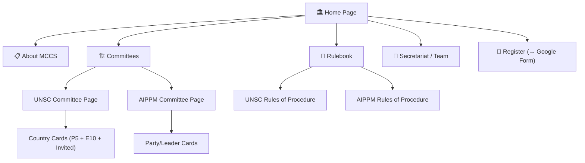

# MCCS Website — Implementation Plan

❯ Scan the Whole Project, It is a Static Website for an Event, @mccs-website-plan.md  This file contains the website plan. But i want you to    
  modify it. The website i want should look, Formal, Cool, Professional and NOT AI Made 
## Goal Description

Build a **multi-page, interactive, professional website** for **MCCS (Model Conferences and Committee Simulation)** — a dual-event conference hosted by **Expresso Club, NIT Patna** comprising:

- **UNSC** (United Nations Security Council) — Dual Delegation | 31 Oct 2026
- **AIPPM** (All India Political Parties Meet) — Single Delegation | 1 Nov 2026

The website must feel **formally prestigious yet interactively alive**, with 3D-inspired scroll animations, a dynamic hero section, interactive country/party cards with flag reveals, and a countdown to the event. It will be built with **React**, styled with a **light & professional** color palette (white/off-white + formal blue & gold), and deployed on **Vercel**.

---

## User Review Required

> [!IMPORTANT]
> **Logo Assets Needed**: You mentioned you have an event logo. Please share:
> - MCCS event logo
> - NIT Patna logo
> - Expresso Club logo
>
> These will be placed in the Navbar, Footer, and About section.

> [!IMPORTANT]
> **Registration Google Form URL**: The "Register Now" button will redirect to a Google Form. Please share the link (can be a placeholder initially).

> [!WARNING]
> **Secretariat Photos & Bios**: You selected "Yes, with photos and bios." Please prepare:
> - Secretary General (name, photo, short bio)
> - Deputy Secretary General
> - Committee Chairs (UNSC & AIPPM)
> - Any other key EB members
>
> We'll use placeholder silhouettes and dummy text until you provide these.

---

## Open Questions

> [!IMPORTANT]
> **Venue**: The rulebook says "NIT Patna (Bihta Campus)" but also "Yet to be Revealed." Should we show the venue name or keep it as "To Be Announced"?

> [!NOTE]
> **Contact Details**: Should there be a Contact Us section? If so, please share an email address, phone number, or social media handles (Instagram, LinkedIn, etc.).

---

## Architecture & Tech Stack

| Layer | Choice | Rationale |
|-------|--------|-----------|
| Framework | **React 18** (Vite) | Fast dev, modern tooling, easy Vercel deploy |
| Routing | **React Router v6** | Multi-page SPA with clean URLs |
| Styling | **Tailwind CSS** | Rapid utility-first styling, consistent design system |
| Animations | **Framer Motion** + **CSS 3D transforms** | Scroll-triggered reveals, 3D card flips, hero typing |
| Typing Effect | **Typewriter Effect** (custom hook) | Hero "MCCS" full-form typing animation |
| Icons | **Lucide React** | Clean, formal icon set |
| Countdown | **Custom hook** | Countdown to 31 Oct 2026 |
| Deployment | **Vercel** | Free tier, instant previews, custom domain support |

---

## Design System

### Color Palette

```
Primary Blue     : #1B3A5C  (deep navy — authority, UN blue family)
Accent Gold      : #C5A55A  (muted gold — prestige, awards)
Light Gold       : #E8D5A3  (soft gold — borders, highlights)
Background       : #FAFAF8  (warm off-white — elegant, not sterile)
Surface          : #FFFFFF  (cards, modals)
Text Primary     : #1A1A2E  (near-black — readability)
Text Secondary   : #4A4A6A  (muted — subtitles, captions)
Accent Blue Light: #2E5D8C  (hover states, links)
Success Green    : #2D6A4F  (for AIPPM Indian context accents)
Border           : #E0DDD5  (subtle warm gray borders)
```

### Typography

| Element | Font | Weight | Size |
|---------|------|--------|------|
| Headlines | **Playfair Display** (serif) | 700 | 48-72px |
| Subheads | **Inter** (sans-serif) | 600 | 24-32px |
| Body | **Inter** | 400 | 16-18px |
| Navbar/UI | **Inter** | 500 | 14-16px |
| Code/Labels | **JetBrains Mono** | 400 | 14px |

> Playfair Display gives a **diplomatic, formal gravitas** (think newspaper headlines, official documents) while Inter ensures modern readability.

---

## Site Structure & Page Map



### Page Breakdown

| # | Page | Route | Description |
|---|------|-------|-------------|
| 1 | **Home** | `/` | Hero + countdown + event overview + CTAs |
| 2 | **About** | `/about` | About MCCS, Expresso Club, NIT Patna, conference format |
| 3 | **UNSC Committee** | `/committees/unsc` | Agenda, delegation format, country matrix cards |
| 4 | **AIPPM Committee** | `/committees/aippm` | Agenda, delegation format, party/leader cards |
| 5 | **Rulebook** | `/rulebook` | Full rules of procedure for both committees |
| 6 | **Secretariat** | `/team` | EB members with photos and bios |
| 7 | **(Register)** | External redirect | Google Form link |

---

## Proposed Changes

### Component Hierarchy

```
src/
├── main.jsx
├── App.jsx                    # Router setup
├── index.css                  # Tailwind + global styles
│
├── components/
│   ├── layout/
│   │   ├── Navbar.jsx         # Sticky nav with logo, links, Register CTA
│   │   └── Footer.jsx         # Logos, quick links, social, copyright
│   │
│   ├── home/
│   │   ├── HeroSection.jsx    # "MCCS" + typing animation + CTA
│   │   ├── CountdownTimer.jsx # Live countdown to 31 Oct 2026
│   │   ├── EventOverview.jsx  # Quick cards for UNSC & AIPPM
│   │   └── HighlightsBar.jsx  # Key stats: 2 committees, 19 delegations, etc.
│   │
│   ├── committees/
│   │   ├── CommitteePage.jsx  # Shared layout for UNSC/AIPPM detail page
│   │   ├── CountryCard.jsx    # Interactive card with flag-slide effect
│   │   ├── PartyCard.jsx      # Similar card for AIPPM parties/leaders
│   │   └── AgendaBanner.jsx   # Full-width agenda statement display
│   │
│   ├── rulebook/
│   │   ├── RulebookPage.jsx   # Tabbed view: UNSC Rules | AIPPM Rules
│   │   ├── RuleSection.jsx    # Collapsible rule section component
│   │   └── MotionTable.jsx    # Motion precedence quick-reference table
│   │
│   ├── team/
│   │   ├── TeamPage.jsx       # Grid of EB member cards
│   │   └── MemberCard.jsx     # Photo + name + designation + bio
│   │
│   └── ui/
│       ├── ScrollReveal.jsx   # 3D scroll-triggered animation wrapper
│       ├── TypeWriter.jsx     # Typing animation hook/component
│       ├── GlowButton.jsx     # Premium CTA button with glow effect
│       └── SectionHeading.jsx # Consistent section title styling
│
├── data/
│   ├── countries.js           # UNSC country data (name, flag URL, type)
│   ├── parties.js             # AIPPM party/leader data
│   ├── rules.js               # Structured rulebook content
│   └── team.js                # Secretariat member data
│
├── hooks/
│   ├── useCountdown.js        # Countdown logic hook
│   ├── useTypewriter.js       # Typewriter effect hook
│   └── useScrollReveal.js     # Intersection Observer hook
│
└── assets/
    ├── logos/                  # MCCS, NIT Patna, Expresso logos
    └── flags/                  # Country flag images (or use API)
```

---

### Page 1: Home Page (`/`)

#### Hero Section — The "MCCS" Moment

The centerpiece of the website. Full-viewport hero with:

1. **"MCCS"** displayed in massive Playfair Display serif, centered
2. Below it, a **typewriter animation** spells out: `Model Conferences and Committee Simulation`
3. Subtle background: a soft geometric pattern or a faint UN-style globe wireframe
4. Two CTAs below:  
   - `Explore Committees` → `/committees/unsc`  
   - `Register Now` → Google Form (external)
5. Gentle **parallax depth** on the background elements

```
┌─────────────────────────────────────────────────┐
│                                                 │
│              M  C  C  S                         │
│                                                 │
│   Model Conferences and Committee Simulation_   │
│                                                 │
│        [ Explore Committees ]  [ Register Now ] │
│                                                 │
│   Organized by Expresso Club, NIT Patna         │
│                                                 │
└─────────────────────────────────────────────────┘
```

#### Countdown Timer

Below the hero — a **live countdown** to `31 October 2026, 08:30 AM IST`:

```
┌──────┐  ┌──────┐  ┌──────┐  ┌──────┐
│  14  │  │  06  │  │  23  │  │  45  │
│ DAYS │  │  HRS │  │ MINS │  │ SECS │
└──────┘  └──────┘  └──────┘  └──────┘
```

Each number box has a subtle **flip animation** on digit change (like an airport departure board).

#### Event Overview Cards

Two side-by-side cards with a 3D hover tilt effect:

| UNSC Card | AIPPM Card |
|-----------|------------|
| 🏛️ UN emblem icon | 🇮🇳 Parliament icon |
| "United Nations Security Council" | "All India Political Parties Meet" |
| Dual Delegation | Single Delegation |
| 31 October 2026 | 1 November 2026 |
| `View Details →` | `View Details →` |

---

### Page 2: About Page (`/about`)

Sections (each scroll-revealed with 3D perspective shifts):

1. **About MCCS** — What the conference is, its vision
2. **About Expresso Club** — Brief about the organizing club
3. **About NIT Patna** — One paragraph + logo
4. **Conference Details** — Venue, dates, timings, dress code, awards, policies
5. **Code of Conduct** — Ethics, electronics policy, decorum (from rulebook)

---

### Page 3 & 4: Committee Pages (`/committees/unsc` and `/committees/aippm`)

Both pages share the same `CommitteePage` layout but are populated with different data.

#### Layout:

```
┌───────────────────────────────────────────────────┐
│  AGENDA BANNER (full-width, formal styling)       │
│  "Escalation to Total Regional Conflict: ..."     │
└───────────────────────────────────────────────────┘

┌─────────────────┐  ┌──────────────────────────────┐
│  COMMITTEE INFO │  │  KEY DETAILS                  │
│  • Type         │  │  • Delegation Format          │
│  • Date         │  │  • Quorum                     │
│  • Venue        │  │  • Total Delegations          │
└─────────────────┘  └──────────────────────────────┘

┌───────────────────────────────────────────────────┐
│  DELEGATION MATRIX — Interactive Country Cards     │
│                                                   │
│  ┌─── P5 (Permanent Members) ───────────────────┐ │
│  │  🇺🇸 USA  🇬🇧 UK  🇫🇷 FR  🇷🇺 RU  🇨🇳 CN   │ │
│  └──────────────────────────────────────────────┘ │
│                                                   │
│  ┌─── E10 (Non-Permanent Members) ──────────────┐ │
│  │  [10 placeholder cards in a responsive grid]  │ │
│  └──────────────────────────────────────────────┘ │
│                                                   │
│  ┌─── Invited Members ──────────────────────────┐ │
│  │  🇮🇱 Israel  🇮🇷 Iran  🇱🇧 Lebanon  🇵🇸 Palestine │
│  └──────────────────────────────────────────────┘ │
└───────────────────────────────────────────────────┘
```

#### 🎌 Country Card — Flag-Slide Interaction (Your Idea!)

This is the showstopper interaction:

```
DEFAULT STATE:                     ON HOVER:
┌──────────────────┐              ┌──────────────────┐
│                  │              │ 🇺🇸🇺🇸🇺🇸🇺🇸🇺🇸🇺🇸🇺🇸│
│  🏛️              │   ──hover──▶ │                  │
│  United States   │              │  United States   │
│  P5 · Veto Power │              │  P5 · Veto Power │
│                  │              │                  │
└──────────────────┘              └──────────────────┘
```

**Technical approach:**
- Card has a `::before` pseudo-element (or an inner `<div>`) with the country's flag as `background-image`
- Default: `width: 0%`, positioned left
- On hover: `width: 100%` with `transition: width 0.5s ease` and `opacity: 0.15` overlay
- Text stays on top with `z-index` and gains a subtle text-shadow for readability
- Optionally add a slight 3D `rotateY(2deg)` perspective tilt on hover

For **AIPPM**, the same card layout but with **party symbols/colors** instead of country flags.

---

### Page 5: Rulebook Page (`/rulebook`)

A **tabbed interface** at the top:

```
  [ UNSC Rules of Procedure ]  [ AIPPM Rules of Procedure ]  [ Quick Reference ]
```

Content rendered as **collapsible accordion sections**:

```
▼ 3.1 Composition & Structure
  ├── Dual Delegation Requirement ...
  ├── P5 Members (with veto power) ...
  └── E10 + Invited Members ...

▶ 3.2 Quorum & Opening of Committee
▶ 3.3 Debate Formats (GSL, Moderated, Unmoderated)
▶ 3.4 Points & Parliamentary Motions
▶ 3.5 Special Procedure for Invited Members
▶ 3.6 Council Documentation & Voting
```

The **Quick Reference** tab renders the Motion Precedence table from Annexure A in a clean, styled `<table>`.

---

### Page 6: Secretariat / Team (`/team`)

A grid of **member cards** with:

```
┌─────────────────────┐
│    ┌───────────┐    │
│    │  PHOTO    │    │
│    │ (circular)│    │
│    └───────────┘    │
│                     │
│   Name Surname      │
│   Secretary General  │
│                     │
│   Short bio text... │
│                     │
│   📧  💼  🔗        │
└─────────────────────┘
```

Cards have a subtle **scale + shadow elevation** on hover.

---

### Interactive & Animation Details

#### 1. Scroll Reveal — 3D Perspective Animations

Using **Framer Motion** with `useInView` and `viewport` props:

```jsx
// Sections slide in from below with a 3D rotation
const variants = {
  hidden: {
    opacity: 0,
    y: 80,
    rotateX: 15,           // tilted away from viewer
    transformPerspective: 1000,
  },
  visible: {
    opacity: 1,
    y: 0,
    rotateX: 0,            // flattens into place
    transition: { duration: 0.8, ease: "easeOut" }
  }
};
```

Different sections get different entrance styles:
- **Cards**: Staggered fade + scale from center
- **Text blocks**: Slide from left with subtle rotateY
- **Stats/numbers**: Count-up animation from 0
- **Images**: Parallax slide with depth

#### 2. Hero Typewriter

```jsx
// Custom hook: useTypewriter("Model Conferences and Committee Simulation")
// Types at ~60ms per character, with a blinking cursor at the end
```

#### 3. Countdown Timer — Flip Animation

Each digit transitions with a CSS `rotateX(-90deg)` flip like a mechanical clock.

#### 4. Navbar

- **Sticky** with blur-glass effect (`backdrop-filter: blur(12px)`)
- On scroll, it gains a subtle shadow and slightly reduces height
- Logo on left, nav links center, **"Register Now"** gold CTA button on right
- **Active page** indicator with an animated underline
- Mobile: hamburger menu with slide-in drawer

---

## Responsive Design

| Breakpoint | Layout |
|------------|--------|
| `≥1280px` | Full desktop layout, side-by-side cards |
| `≥768px` | Tablet, 2-column grids |
| `<768px` | Mobile, single column, hamburger nav |

All country/party cards reflow into a scrollable list on mobile.

---

## Proposed File Changes

### [NEW] Project scaffold

| File | Purpose |
|------|---------|
| `package.json` | React, Vite, Tailwind, Framer Motion, React Router |
| `vite.config.js` | Vite configuration |
| `tailwind.config.js` | Custom colors, fonts, animations |
| `index.html` | Entry point with Google Fonts link |
| `src/main.jsx` | React DOM render |
| `src/App.jsx` | Router with all page routes |
| `src/index.css` | Tailwind directives + custom CSS |
| All components in `src/components/` | As listed in Component Hierarchy above |
| All data files in `src/data/` | Countries, parties, rules, team |
| All hooks in `src/hooks/` | Countdown, typewriter, scroll reveal |

**Estimated total**: ~25-30 files

---

## Verification Plan

### Automated Tests

```bash
# Build check — ensures no compilation errors
npm run build

# Development server — visual verification
npm run dev
```

### Manual Verification

1. **Hero Section**: Verify "MCCS" displays with typewriter animation for the full form
2. **Countdown**: Confirm countdown ticks live and flip-animation works
3. **Navigation**: Click all nav links → correct pages load, active state shows
4. **Committee Pages**: Switch between UNSC and AIPPM tabs, verify correct data
5. **Country Cards**: Hover over cards → flag slides in from left to right
6. **Rulebook**: Click accordion sections → expand/collapse smoothly
7. **Team Page**: Cards display with hover elevation effect
8. **Register Button**: Redirects to Google Form (or placeholder)
9. **Responsive**: Test at mobile (375px), tablet (768px), and desktop (1440px)
10. **Scroll Animations**: Scroll through all pages → 3D reveal animations trigger

### Deployment

```bash
# Deploy to Vercel
npx vercel
```

---

## Implementation Phases

| Phase | Scope | Priority |
|-------|-------|----------|
| **Phase 1** | Project setup, design system, Navbar, Footer, Home page (Hero + Countdown + Overview) | 🔴 Critical |
| **Phase 2** | Committee pages (UNSC + AIPPM) with interactive country/party cards | 🔴 Critical |
| **Phase 3** | Rulebook page with tabbed accordion layout | 🟡 High |
| **Phase 4** | Team/Secretariat page | 🟡 High |
| **Phase 5** | About page, final polish, responsive QA, deployment | 🟢 Medium |

---

## Summary

This plan delivers a **premium, formal, interactive** MCCS conference website that:

- ✅ Opens with a dramatic "MCCS" hero with typewriter animation
- ✅ Counts down to the event with flip-clock aesthetics
- ✅ Presents UNSC & AIPPM as unified but distinct committee experiences
- ✅ Features the **flag-sliding country cards** you envisioned
- ✅ Houses the complete rulebook in an elegant, navigable format
- ✅ Showcases the Secretariat team professionally
- ✅ Drives registration with prominent CTAs to the Google Form
- ✅ Feels interactive and alive through 3D scroll animations
- ✅ Deploys effortlessly on Vercel
